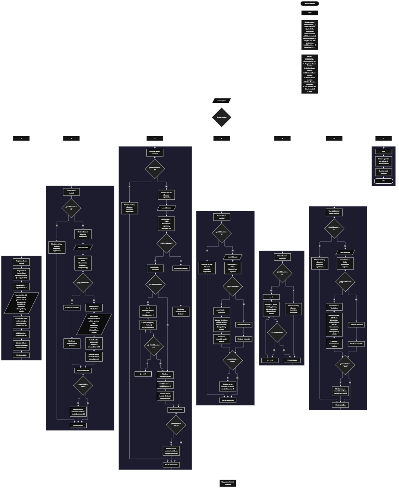

Este proyecto, llamado <b>álbum musical</b>, fue desarrollado en <b>PSeInt</b> como un ejercicio práctico para fortalecer la lógica de programación mediante la creación de un sistema de gestión de álbumes musicales desde la consola. El programa cuenta con un menú principal de siete opciones que permite <b>registrar, editar, eliminar, buscar, listar y consultar los detalles</b> de los álbumes musicales registrados. Cada álbum almacena información como su nombre, artista, género musical, año de lanzamiento, cantidad de canciones, discográfica y estado, utilizando ocho arreglos con una capacidad declarada de <b>100 posiciones</b> para almacenar los datos durante la ejecución. Durante su desarrollo se aplicaron conceptos fundamentales de programación, como variables, arreglos, estructuras condicionales, ciclos repetitivos y estructuras de selección, además de procedimientos lógicos para buscar, modificar, eliminar y recorrer registros. Este proyecto permite poner en práctica los conocimientos adquiridos en PSeInt y sirve como base para desarrollar sistemas de gestión más avanzados utilizando otros lenguajes y tecnologías.

<h2 align="center">⚙️ Funcionamiento del menú principal</h2>

### ➕ Registrar álbum musical

La opción <b>1) registrar álbum musical</b> permite agregar un nuevo álbum a la colección. Al iniciar el registro, el programa asigna un identificador utilizando el arreglo <b>id</b> y la variable <b>siguienteID</b>. Inicialmente, el identificador comienza en <b>1</b> y aumenta en uno después de cada asignación. A continuación, solicita el <b>nombre del álbum, artista, género musical, año de lanzamiento, cantidad de canciones, discográfica y estado</b>. Los datos se almacenan en la posición <b>totalAlbumes + 1</b> de sus respectivos arreglos. Después de completar el registro, la variable <b>totalAlbumes</b> aumenta en uno y el programa muestra el mensaje <b>"álbum musical registrado correctamente."</b>. El código declara 100 posiciones para cada arreglo, aunque actualmente no comprueba si se ha alcanzado la capacidad máxima antes de registrar otro álbum.

### ✏️ Editar álbum musical

La opción <b>2) editar álbum musical</b> permite modificar la información de un álbum registrado. Primero, el programa comprueba si la variable <b>totalAlbumes</b> es igual a <b>0</b>. Si no existen álbumes registrados, muestra el mensaje <b>"no hay álbumes musicales registrados."</b>. En caso contrario, presenta una lista con el ID, nombre del álbum, artista, género, año de lanzamiento, cantidad de canciones, discográfica y estado de cada registro. Después, solicita el identificador del álbum que se desea editar e inicializa la variable lógica <b>encontrado</b> con el valor <b>Falso</b>. Mediante un ciclo <b>Para</b>, recorre los identificadores almacenados y los compara con el valor introducido utilizando la condición <b>id[i] = idBuscar</b>. Si encuentra una coincidencia, cambia <b>encontrado</b> a <b>Verdadero</b> y solicita los nuevos datos del álbum, actualizando los arreglos correspondientes sin modificar su ID. Finalmente, muestra el mensaje <b>"álbum musical editado correctamente."</b>. Si no encuentra coincidencias, presenta el mensaje <b>"no se encontró un álbum musical con ese id."</b>.

### 🗑️ Eliminar álbum musical

La opción <b>3) eliminar álbum musical</b> permite eliminar un álbum mediante su identificador. Antes de comenzar, el programa comprueba si existen álbumes registrados. Si la colección está vacía, muestra el mensaje <b>"no hay álbumes musicales registrados."</b>. Si existen registros, presenta una lista con la información almacenada y solicita el ID del álbum que se desea eliminar. A continuación, inicializa <b>encontrado</b> en <b>Falso</b> y recorre los registros mediante un ciclo <b>Para</b>. Cuando encuentra el ID solicitado, cambia la variable a <b>Verdadero</b> y comprueba si la posición del álbum es menor que <b>totalAlbumes</b>. Si se cumple la condición, utiliza otro ciclo <b>Para</b>, controlado por la variable <b>j</b>, para desplazar una posición hacia atrás los datos de los registros posteriores en los ocho arreglos: <b>id, album, artista, genero, anio, canciones, discografica y estado</b>. Después, disminuye <b>totalAlbumes</b> en uno y muestra el mensaje <b>"álbum musical eliminado correctamente."</b>. Si el ID no coincide con ningún registro, muestra el mensaje <b>"no se encontró un álbum musical con ese id."</b>. El código actual no incluye una instrucción para detener explícitamente el ciclo de búsqueda después de eliminar un registro, por lo que conviene revisar ese recorrido para evitar procesar posiciones incorrectas.

### 🔎 Buscar álbum musical

La opción <b>4) buscar álbum musical</b> permite localizar un álbum mediante su ID. Primero, el programa comprueba si existen álbumes registrados. Si no hay registros, muestra el mensaje <b>"no hay álbumes musicales registrados."</b>. En caso contrario, solicita el identificador del álbum y establece la variable lógica <b>encontrado</b> en <b>Falso</b>. Después, utiliza un ciclo <b>Para</b> para recorrer los registros y comparar cada identificador con el valor introducido mediante la condición <b>id[i] = idBuscar</b>. Cuando encuentra una coincidencia, cambia la variable a <b>Verdadero</b> y muestra el mensaje <b>"datos registrados encontrados"</b>, seguido del ID, nombre del álbum, artista, género, año de lanzamiento, cantidad de canciones, discográfica y estado. Si finaliza el recorrido sin encontrar el identificador, presenta el mensaje <b>"no se encontró un álbum musical con ese id."</b>. Esta función permite consultar un registro específico sin necesidad de mostrar toda la colección.

### 📋 Listar álbumes musicales

La opción <b>5) listar álbumes musicales</b> permite visualizar todos los álbumes registrados. Antes de mostrar la información, el programa comprueba si la variable <b>totalAlbumes</b> es igual a <b>0</b>. Si no existen registros, presenta el mensaje <b>"no hay álbumes musicales registrados."</b>. Si hay álbumes disponibles, muestra el encabezado <b>"datos registrados"</b> y utiliza un ciclo <b>Para</b> para recorrer las posiciones desde la primera hasta la última ocupada. Durante el recorrido, presenta el ID, nombre del álbum, artista, género musical, año de lanzamiento, cantidad de canciones, discográfica y estado de cada registro. Esta función facilita consultar la colección completa sin tener que buscar los álbumes individualmente.

### 📄 Ver detalles del álbum musical

La opción <b>6) ver detalles del álbum musical</b> permite consultar la información completa de un álbum específico. Primero, el programa comprueba si existen registros mediante la variable <b>totalAlbumes</b>. Si no hay álbumes registrados, muestra el mensaje <b>"no hay álbumes musicales registrados."</b>. En caso contrario, solicita el ID del álbum que se desea consultar e inicializa <b>encontrado</b> con el valor <b>Falso</b>. Después, utiliza un ciclo <b>Para</b> para recorrer los identificadores y compararlos con el valor introducido. Si encuentra una coincidencia, cambia la variable a <b>Verdadero</b> y muestra el encabezado <b>"detalles del álbum musical"</b>, seguido de cada campo por separado: <b>ID, álbum, artista, género, año de lanzamiento, cantidad de canciones, discográfica y estado</b>. Si no encuentra el ID solicitado, muestra el mensaje <b>"no se encontró un álbum musical con ese id."</b>.

### 🚪 Salir del menú principal

La opción <b>7) salir</b> permite finalizar el programa y muestra el mensaje <b>"gracias por utilizar el álbum musical."</b>. El menú principal está dentro de una estructura repetitiva <b>Repetir ... Hasta Que</b>, que mantiene el programa en funcionamiento mientras el usuario realiza las operaciones disponibles. En el código actual, la condición de salida es <b>Hasta Que opcion = 7</b>, por lo que coincide con la opción 7 del menú. Cuando el usuario selecciona esta opción, el ciclo principal finaliza y el programa termina su ejecución.

<h2 align="center">🧠 Temas aplicados en el proyecto</h2>

### 📦 Variables

En este proyecto se utilizan variables para almacenar la opción seleccionada en el menú, controlar la cantidad de álbumes registrados, generar identificadores consecutivos, recorrer los arreglos y determinar si se encontró un álbum. También se utilizan variables para guardar temporalmente el identificador que se desea buscar, editar o eliminar. Cada variable cumple una función específica dentro de las operaciones de gestión musical.

🔢 **Opcion:** almacena la opción seleccionada por el usuario en el menú principal.

📊 **TotalAlbumes:** controla la cantidad actual de álbumes registrados.

🔄 **I:** funciona como contador para recorrer los arreglos y acceder a las posiciones de los álbumes.

🔁 **J:** controla el recorrido utilizado para desplazar los registros durante la eliminación de un álbum.

🔎 **IdBuscar:** almacena el identificador introducido por el usuario para localizar un álbum.

🆔 **SiguienteID:** genera los identificadores consecutivos asignados a los nuevos álbumes.

✅ **Encontrado:** variable lógica que indica si se encontró un álbum con el ID solicitado.

### 🗃️ Arreglos

El programa utiliza ocho arreglos relacionados entre sí para almacenar los datos de los álbumes musicales. Cada arreglo tiene una capacidad declarada de <b>100 posiciones</b> y utiliza el mismo índice para representar la información correspondiente a un mismo álbum. Por ejemplo, los datos almacenados en la posición <b>1</b> se distribuyen entre <b>id[1], album[1], artista[1], genero[1], anio[1], canciones[1], discografica[1] y estado[1]</b>. Esta organización permite recorrer, buscar, modificar, mostrar y eliminar registros manteniendo relacionados sus campos.

🆔 **Id[100]:** almacena los identificadores de los álbumes musicales.

💿 **Album[100]:** almacena los nombres de los álbumes.

🎤 **Artista[100]:** almacena los nombres de los artistas.

🎵 **Genero[100]:** almacena los géneros musicales.

📅 **Anio[100]:** almacena los años de lanzamiento.

🔢 **Canciones[100]:** almacena la cantidad de canciones de cada álbum.

🏢 **Discografica[100]:** almacena los nombres de las discográficas.

📌 **Estado[100]:** almacena el estado de cada álbum musical.

### 🔀 Estructuras condicionales

En el proyecto se utilizan las estructuras <b>Si</b> y <b>SiNo</b> para comprobar si existen álbumes registrados, determinar si un identificador coincide con el solicitado, decidir si es necesario desplazar registros durante una eliminación y comprobar si se encontró un álbum. Estas condiciones permiten ejecutar diferentes instrucciones según el resultado de cada comprobación. Por ejemplo, la condición <b>totalAlbumes = 0</b> permite identificar si la colección está vacía, mientras que <b>id[i] = idBuscar</b> permite localizar el registro correspondiente.

### 🔄 Estructuras repetitivas

El programa utiliza las estructuras repetitivas <b>Para</b> y <b>Repetir ... Hasta Que</b>. Los ciclos <b>Para</b> permiten recorrer los arreglos durante las operaciones de edición, eliminación, búsqueda, listado y consulta de detalles. En la eliminación también se utiliza un ciclo adicional para desplazar los datos de los álbumes posteriores hacia las posiciones anteriores. Por otro lado, el ciclo <b>Repetir ... Hasta Que</b> mantiene activo el menú principal hasta que el usuario selecciona la opción <b>7</b>, permitiendo realizar varias operaciones durante una misma ejecución.

### 🎯 Estructura según

La estructura <b>Segun opcion Hacer</b> evalúa el valor almacenado en la variable <b>opcion</b> y ejecuta el bloque de instrucciones correspondiente. Cada caso representa una operación del sistema: <b>registrar álbum musical, editar álbum musical, eliminar álbum musical, buscar álbum musical, listar álbumes musicales, ver detalles del álbum musical o salir</b>. Además, el bloque <b>De Otro Modo</b> permite mostrar el mensaje <b>"opción no válida."</b> cuando el usuario introduce un valor que no coincide con ninguna de las opciones definidas.

### 🔢 Dimensionamiento de arreglos

El programa utiliza la instrucción <b>Dimension</b> para declarar ocho arreglos con <b>100 posiciones</b> cada uno. Estos arreglos almacenan los campos correspondientes a cada álbum musical. La variable <b>totalAlbumes</b> controla cuántos registros se consideran activos durante la ejecución, mientras que <b>siguienteID</b> genera los identificadores de los nuevos registros. Aunque los arreglos tienen 100 posiciones declaradas, el código actual no comprueba si se ha alcanzado ese límite antes de realizar un nuevo registro.

### 🆔 Generación de identificadores

La generación de identificadores se realiza mediante la variable <b>siguienteID</b>, que comienza con el valor <b>1</b>. Cuando se registra un álbum, el programa asigna ese valor a <b>id[totalAlbumes + 1]</b> y posteriormente incrementa <b>siguienteID</b> en uno. De esta manera, los nuevos álbumes reciben identificadores consecutivos. El identificador se conserva durante la edición y no se reutiliza automáticamente después de eliminar un registro, porque la variable <b>siguienteID</b> continúa aumentando durante la ejecución.

### 🔄 Reorganización de registros

Cuando se elimina un álbum que no ocupa la última posición, el programa utiliza la variable <b>j</b> para recorrer las posiciones posteriores y copiar los datos de cada posición siguiente sobre la posición actual. Esta operación se aplica a los ocho arreglos: <b>id, album, artista, genero, anio, canciones, discografica y estado</b>. Después del desplazamiento, la variable <b>totalAlbumes</b> disminuye en uno para reflejar la nueva cantidad de registros activos. El código no limpia explícitamente la última posición que queda fuera del total actualizado, por lo que esa posición deja de formar parte del listado activo, aunque sus valores puedan permanecer almacenados en los arreglos.

<h2 align="center">¿Cómo se implementaron las operaciones CRUD en el proyecto?</h2>

Las operaciones <b>CRUD</b> se implementaron mediante las opciones del menú principal y permiten gestionar la información de los álbumes musicales. La operación <b>Crear</b> corresponde a <b>registrar álbum musical</b>, donde se solicitan y almacenan los datos de un nuevo álbum. La operación <b>Leer</b> se realiza mediante las opciones <b>buscar álbum musical, listar álbumes musicales y ver detalles del álbum musical</b>, que permiten consultar los registros almacenados. La operación <b>Actualizar</b> corresponde a <b>editar álbum musical</b>, donde se modifican los datos de un registro existente. Por último, la operación <b>Eliminar</b> corresponde a <b>eliminar álbum musical</b>, donde se retira un registro y se desplazan los datos posteriores para reorganizar las posiciones activas. Todas estas operaciones utilizan variables, arreglos, condicionales y ciclos para administrar la información durante la ejecución del programa.

<h2 align="center">Diagrama de flujo del proyecto</h2>

El diagrama de flujo representa la estructura del programa <b>Álbum Musical</b>, desde la inicialización de las variables y los arreglos hasta el menú principal y sus siete opciones. También muestra las decisiones que se toman al comprobar si existen registros, buscar identificadores, editar los datos, eliminar álbumes y recorrer los arreglos. Finalmente, representa el retorno al menú principal después de cada operación y la finalización del programa cuando se selecciona la opción de salida.

<h2 align="center">🛡️ Validaciones y consideraciones del programa</h2>

### 📭 No existen álbumes musicales registrados

Esta comprobación se utiliza en las opciones de <b>editar, eliminar, buscar, listar y ver detalles del álbum musical</b>. El programa verifica si <b>totalAlbumes = 0</b>. Si la colección está vacía, muestra el mensaje <b>"no hay álbumes musicales registrados."</b> y no continúa con la operación que requiere registros existentes. Esta comprobación evita intentar localizar o mostrar información de álbumes cuando todavía no se ha registrado ninguno.

### ❌ Álbum musical no encontrado

Esta comprobación se utiliza en las operaciones de <b>editar, eliminar, buscar y ver detalles del álbum musical</b>. Antes de recorrer los identificadores, el programa establece la variable lógica <b>encontrado</b> en <b>Falso</b>. Si encuentra un ID coincidente, cambia su valor a <b>Verdadero</b>. Al finalizar el recorrido, si la variable continúa siendo <b>Falso</b>, muestra el mensaje <b>"no se encontró un álbum musical con ese id."</b>. De esta manera, el programa informa cuando el identificador introducido no corresponde a un registro localizado.

### ⚠️ Capacidad máxima de los arreglos

Los ocho arreglos tienen una capacidad declarada de <b>100 posiciones</b>. Sin embargo, en el código actual no existe una condición que compruebe si <b>totalAlbumes &lt; 100</b> antes de registrar un nuevo álbum. Por esta razón, el límite de almacenamiento no está protegido mediante una validación explícita. Para mejorar el programa, sería conveniente comprobar la disponibilidad de espacio antes de asignar un nuevo registro y mostrar un mensaje si se alcanza la capacidad máxima.

### 🔢 Validación de la opción del menú

La estructura <b>Segun</b> incluye el bloque <b>De Otro Modo</b>, que muestra el mensaje <b>"opción no válida."</b> cuando el usuario introduce un valor que no corresponde a las opciones del menú, del <b>1</b> al <b>7</b>. Esta respuesta permite informar al usuario de que debe seleccionar una de las opciones disponibles. El código no restringe el tipo de entrada antes de leerla, por lo que no incorpora una validación específica para entradas que no sean números enteros.

### 🔄 Consideraciones al eliminar un álbum

Durante la eliminación, el programa desplaza los datos de los registros posteriores y disminuye <b>totalAlbumes</b>. Sin embargo, el ciclo que recorre los álbumes no incluye una instrucción para detener explícitamente la búsqueda después de encontrar y eliminar un registro. Por ello, es recomendable revisar la lógica de ese ciclo para evitar que el recorrido continúe con posiciones que hayan cambiado después de la eliminación. Asimismo, la última posición deja de considerarse activa al reducirse el contador, pero sus valores no se borran explícitamente de los arreglos.

<h2 align="center">🎯 Objetivo del proyecto</h2>

El objetivo principal de este proyecto es fortalecer la <b>lógica de programación</b> mediante el desarrollo de un sistema de gestión de álbumes musicales en <b>PSeInt</b>. A través de su construcción se busca aplicar los conocimientos adquiridos sobre variables, arreglos, estructuras condicionales, ciclos repetitivos y estructuras de selección, integrándolos para resolver un problema de manera organizada. Además, el proyecto permite comprender cómo registrar, consultar, modificar y eliminar información en una aplicación de consola, trabajar con identificadores y mantener organizados los datos mediante arreglos relacionados. Estos conocimientos constituyen una base para desarrollar sistemas de gestión más completos con otros lenguajes y tecnologías.

